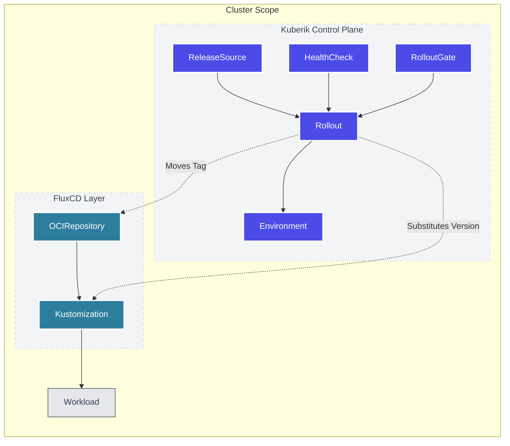

See which Kuberik resources take part in a release, how they connect to Flux, and what happens to a build from discovery to verification.

## System Overview

## Component Roles

| Component | Purpose |
|-----------|---------|
| **Rollout** | The core state machine. Reads the releases a `ReleaseSource` discovers and orchestrates releases. Drives either a `Kustomization` substitution or an `OCIRepository` tag. |
| **ReleaseSource** | Lists the tags of an OCI repository, orders them by a policy and keeps the catalogue of releases (served by the release-controller). A Rollout points at one with `spec.releaseSourceRef`. |
| **Environment** | Maps a Rollout to a logical target (e.g. "production") and syncs status to external backends (GitHub). |
| **HealthCheck** | Reports health from a Flux `Kustomization` or from Datadog monitors. The Rollout reads it before and during the bake. |
| **RolloutGate** | Holds builds until it allows them: written by hand, or by schedules, approval policies, service dependencies and Environments. |

## The Release Lifecycle

{}

### Discovery

A `ReleaseSource` finds a new tag in the OCI repository and adds it to its catalogue of releases. The Rollout lists every release newer than the deployed one in `status.candidates`.

### Gating

`RolloutGates` are evaluated. If any gate does not allow the build, the build waits until a gate changes.

### Execution

Kuberik updates the Flux source it owns: a substitution variable on a `Kustomization`, or the tag on an `OCIRepository`. Flux applies the changes. See [Propagation Modes](/docs/concepts/propagation/).

### Bake Time

Once every selected health check is healthy, Kuberik waits for `bakeTime` and watches for errors.

### Verification

`HealthChecks` report continuously, and the deploy ends with one bake status:

-  No health check reported an error since the deploy, and the bake ran its full `bakeTime`. Downstream environments can now admit the build through their gates.
-  A health check reported an error. The build keeps running and further automatic deploys are held until someone acts; see [When a Bake Fails](/docs/concepts/rollouts/#when-a-bake-fails).

{}
