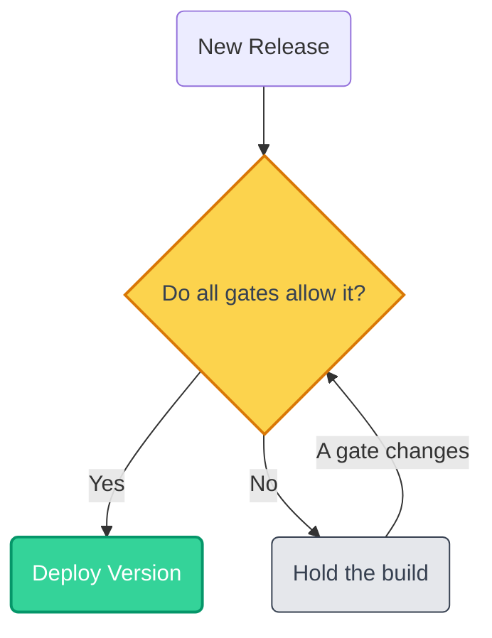
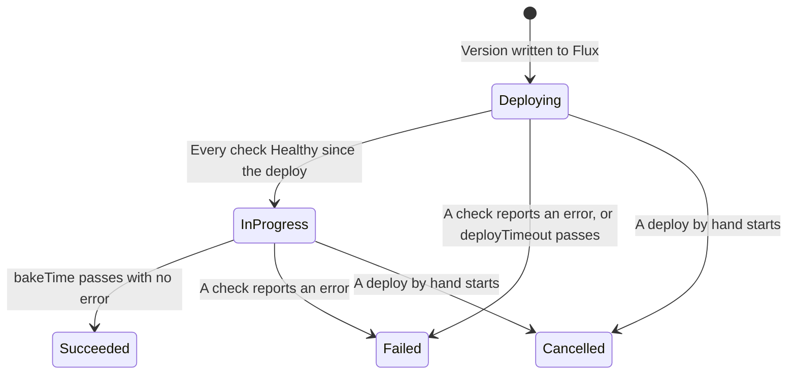

A **Rollout** deploys the builds of one OCI artifact into one environment, one build at a time, and holds further deploys when a build fails its health checks. The artifact is either your container image or the rendered manifests for that environment.

## Follow a Build Through a Rollout

A Rollout reads its releases from a [`ReleaseSource`](/docs/reference/api/), which lists the tags of an OCI repository. For every new release, the Rollout:

{}

### Lists the Candidates
Every release newer than the deployed one becomes a candidate in `status.candidates`.

### Evaluates Gates
The newest candidate that every [gate](#gating-process) allows is the one to deploy.

### Updates Deployment
Writes the version to the Flux source it owns: a `Kustomization` substitution variable, or an `OCIRepository` tag.

### Watches Health
Waits until the selected health checks are healthy, then [bakes](#verification-cycle) the build for `bakeTime`.

### Records the Outcome
The deployment's history entry ends with bake status `Succeeded` or `Failed`.

{}

## Rollout Resource

```yaml {filename="rollout-structure.yaml"}
apiVersion: kuberik.com/v1alpha1
kind: Rollout
metadata:
  name: my-app
  namespace: default
spec:
  # Read new versions from this ReleaseSource
  releaseSourceRef:
    name: my-app

  # How many versions to keep in history
  versionHistoryLimit: 5

  # Fail the deploy if health checks are not healthy within 10 minutes
  deployTimeout: 10m

  # Stabilization period once health checks are healthy
  bakeTime: 15m

  # Select which HealthChecks to evaluate
  healthCheckSelector:
    selector:
      matchLabels:
        app: my-app
```

## Key Fields

| Field | Purpose |
|-------|---------|
| `releaseSourceRef` | Reference to the `ReleaseSource` that provides new versions. Resolved in the Rollout's namespace. |
| `releasesImagePolicy` | Deprecated and ignored. Use `releaseSourceRef`. |
| `versionHistoryLimit` | How many past deployments to keep in `status.history` (default `10`) |
| `bakeTime` | How long the build must stay free of health-check errors once the bake starts (e.g., `5m`, `1h`) |
| `deployTimeout` | How long to wait for the health checks to become healthy after a deploy. When it passes before the bake starts, the deploy fails. Unset means wait indefinitely. |
| `healthCheckSelector` | Label selector (and optional namespace selector) for the HealthCheck resources to evaluate |
| `wantedVersion` | Pins the Rollout to one version: it deploys that tag and nothing else until you clear the field. See [Operate a Rollout by Hand](/docs/guides/operate-rollout/#pin-a-version). |

## Rollout Status

The Rollout's status shows what is deployed, what could deploy next, and what holds it:


```bash
kubectl get rollout my-app -o yaml
```

Key status fields:
- `history`: deployments, newest first. `history[0].version.tag` is the running version; each entry records its `message`, `triggeredBy` and `bakeStatus` (`Deploying`, `InProgress`, `Succeeded`, `Failed` or `Cancelled`).
- `candidates`: releases newer than the deployed one. `gated: true` means every gate lets the release through; `blockedBy` names the gates that hold it.
- `gates`: each gate that targets this Rollout, whether it is passing, and the versions it allows.
- `conditions`: `Ready`, `GatesPassing`, `DeploymentBlocked` (a health check is unhealthy) and `BakeFailureDisabled` (see [When a Bake Fails](#when-a-bake-fails)).

## What a Rollout Propagates

A Rollout does not care what its versions point at. Annotate a `Kustomization` and Kuberik substitutes the version into it; annotate an `OCIRepository` and Kuberik moves its tag. Gating, health checks and bake time work the same way in both cases.

See [Propagation Modes](/docs/concepts/propagation/) for the trade-offs and for running both at once.

## Gating Process

Before an automatic deploy, the build must be allowed by every gate that targets the Rollout. A gate either lets a build through or holds it; nothing is rejected for good.



A held build is evaluated again whenever a gate changes; there is no polling interval. Gates do not apply to a Rollout's first deploy (if no release passes them, the newest release deploys) or to deploys you start by hand.


**Unhealthy Checks Hold Automatic Deploys**

While any selected health check reports `Unhealthy`, automatic deploys wait and the Rollout sets `DeploymentBlocked=True` with the name of the check. A check that is still `Pending` does not hold anything. A Rollout's first deploy and deploys you start by hand go ahead regardless.


## Verification Cycle

After a deploy, the history entry starts in `Deploying`. The bake starts once every selected health check is `Healthy` and has changed state since the deploy, so a check that was healthy before the deploy does not count until it reports on the new build.



A health check that reports an error at any point after the deploy fails it, before or during the bake. A Rollout with no `bakeTime`, `deployTimeout` or `healthCheckSelector` marks each deploy `Succeeded` straight away.

## Sequential Processing


**One Version at a Time**

Kuberik deploys **one version at a time**. If `v1.2.0` is deploying or baking when `v1.3.0` and `v1.4.0` arrive, both wait as candidates. When `v1.2.0` succeeds, the Rollout deploys the newest candidate the gates allow, `v1.4.0`, and skips `v1.3.0`.


## When a Bake Fails

Kuberik does not roll back. When a bake fails, the failed build keeps running, the Rollout sets `Ready=False`, and no newer build deploys automatically until a person acts:

- pin a version with `spec.wantedVersion`,
- deploy a build by hand, with the `rollout.kuberik.com/force-deploy` annotation or the dashboard's **Change version**,
- set `rollout.kuberik.com/unblock-failed: "true"` to let the next automatic deploy through,
- or retry the bake of the same build with `rollout.kuberik.com/retry`.

[Operate a Rollout by Hand](/docs/guides/operate-rollout/) shows each of these.


### Recovery Deploys (`BakeFailureDisabled`)

When a deploy starts, the Rollout sets the `BakeFailureDisabled` condition for that deploy. It is `True`, and health-check errors and `deployTimeout` do not fail that deploy, in two cases:

| Reason | When |
|--------|------|
| `PreviousBakeFailed` | The previous deploy did not end with a successful bake: it failed, or this deploy cancelled its bake. |
| `DeployedWithUnhealthyHealthChecks` | A deploy you started by hand began while a selected health check was `Unhealthy`. |

The deploy still has to bake: it succeeds once the checks are healthy for `bakeTime`. If they never recover, it stays in `Deploying`, and the next build has to be deployed by hand. The condition holds until the next deploy starts.

## Related Guides

- [Getting Started](/docs/getting-started/): set up your first Rollout
- [Propagation Modes](/docs/concepts/propagation/): image tag or rendered manifests
- [Health Checks](/docs/guides/health-checks/): configure verification
- [Manual Approvals](/docs/guides/manual-approvals/): add approval gates
- [Operate a Rollout by Hand](/docs/guides/operate-rollout/): pin, deploy, bypass gates and recover from a failed bake
- [Deployment Schedules](/docs/guides/schedules/): control deployment time windows
